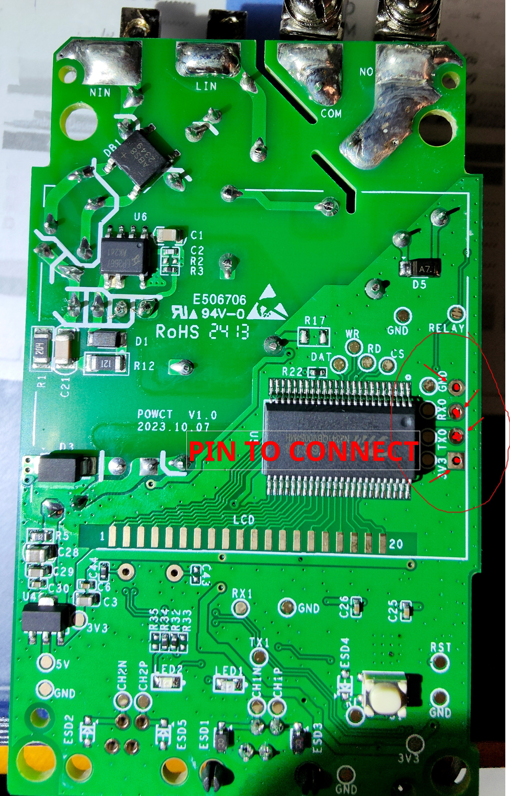

**English** | [Français](INSTALL_FR.md)

***

## 🛠️ Initial Flashing Procedure

To perform the **initial firmware flash** on your device, you'll need to follow a few hardware preparation steps.

---

### **Step 1: Hardware Preparation (🚨 Power OFF!)**

First, you must **open the device casing** while it is **powered OFF** (unplugged or disconnected from mains voltage) to ensure safety.

Inside the device, you need to **solder four connector wires** to the clearly marked programming points on the board: **3.3V, TX, RX, and GND**. These are the standard connections required for flashing ESP-based devices.

**_Example of soldering points on the Sonoff POW CT board:_**

| Pin | Function |
| :--- | :--- |
| **3.3V** | Power supply |
| **TX** | Transmit Data |
| **RX** | Receive Data |
| **GND** | Ground |

---

### **Step 2: Connecting to Your PC**

Next, you'll need an **USB-to-TTL Serial Adapter** to bridge the connection between the device and your computer. A common and reliable example is a module based on the **CP2102** chip.

1.  Connect the wires you just soldered on the device to the corresponding pins on the USB-to-TTL adapter:

    * Device **3.3V** $\rightarrow$ Adapter **3.3V**
    * Device **TX** $\rightarrow$ Adapter **RX**
    * Device **RX** $\rightarrow$ Adapter **TX**
    * Device **GND** $\rightarrow$ Adapter **GND**

2.  Plug the USB-to-TTL adapter into a free **USB port** on your PC.

💡 **Pro Tip:** Make sure to cross the TX/RX connections (**TX** to **RX** and **RX** to **TX**).

---

### **Step 3: Flashing the Firmware (ESPHome)**

Once the hardware is connected, you can proceed with the firmware upload using the ESPHome platform.

1.  Place the device into **Flashing/Bootloader Mode**. This can be achieved by pressing and holding the button while connecting the GND pin, but you may also need to experiment with the +3.3V pin to find the right connection timing...
2.  Use the **standard ESPHome flashing method** (e.g., the ESPHome Dashboard, command line, or the Web Flasher) to upload the firmware.
3.  Utilize the **YAML configuration templates** provided in the root of this repository.

> **Important — which image should I flash?**
> For the first flash, use a **factory** image (bootloader + partition table +
> application), not an app-only/OTA image. The ESPHome Web Flasher/dashboard
> handles this automatically.
> If you flash manually with `esptool`, follow the
> [Flashing guide](FLASHING.md): it explains factory vs app-only images, offsets,
> backups and recovery. Never write an app-only image at `0x0` or `0x10000`.

> **Configuration secrets:** copy [`secrets.yaml.example`](../secrets.yaml.example)
> to `secrets.yaml` and fill in the Wi-Fi, fallback AP and API encryption key.
> The API key is also used for encrypted OTA (`ota: encryption:`); no separate
> OTA password is needed. `secrets.yaml` is ignored by Git.
>
> **Local component:** the local YAML expects `my_components/cse7761`. Copy
> `components/cse7761` there, or use the distant YAML which pulls the component
> from GitHub.

🔗 **Video Tutorial:** If you are new to this process, you might find this guide helpful: [How to Install ESPHome on Sonoff Basic and Home Assistant](http://www.youtube.com/watch?v=4Q3whVVVwYw) by Reid Projects.

***
