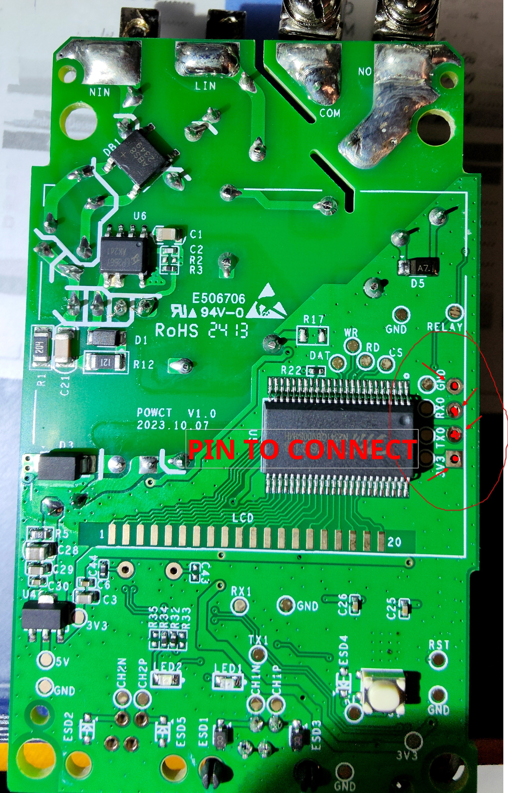

[English](INSTALL.md) | **Français**

***

## 🛠️ Procédure de Flashe Initial

Pour effectuer le **flashe initial du firmware** sur votre appareil, vous devrez suivre quelques étapes de préparation matérielle.

---

### **Étape 1 : Préparation Matérielle (🚨 Mettre HORS TENSION !) **

Premièrement, vous devez **ouvrir le boîtier de l'appareil** pendant qu'il est **HORS TENSION** (débranché ou déconnecté de la tension secteur) pour garantir la sécurité.

À l'intérieur de l'appareil, vous devez **souder quatre fils de connexion** aux points de programmation clairement marqués sur la carte : **3.3V, TX, RX et GND**. Ce sont les connexions standard requises pour flasher les appareils basés sur ESP.

**_Exemple des points de soudure sur la carte Sonoff POW CT :_**

| Broche | Fonction |
| :--- | :--- |
| **3.3V** | Alimentation |
| **TX** | Transmission de Données |
| **RX** | Réception de Données |
| **GND** | Masse (Terre) |

---

### **Étape 2 : Connexion à Votre PC**

Ensuite, vous aurez besoin d'un **Adaptateur Série USB-à-TTL** pour établir le pont entre l'appareil et votre ordinateur. Un exemple courant et fiable est un module basé sur la puce **CP2102**.

1.  Connectez les fils que vous venez de souder sur l'appareil aux broches correspondantes de l'adaptateur USB-à-TTL :

    * Appareil **3.3V** $\rightarrow$ Adaptateur **3.3V**
    * Appareil **TX** $\rightarrow$ Adaptateur **RX**
    * Appareil **RX** $\rightarrow$ Adaptateur **TX**
    * Appareil **GND** $\rightarrow$ Adaptateur **GND**

2.  Branchez l'adaptateur USB-à-TTL sur un **port USB** libre de votre PC.

💡 **Astuce de Pro :** Assurez-vous de croiser les connexions TX/RX (**TX** vers **RX** et **RX** vers **TX**).

---

### **Étape 3 : Téléversement du micrologiciel (ESPHome)**

Une fois le matériel connecté, vous pouvez procéder au téléversement du micrologiciel à l'aide de la plateforme ESPHome.

1. Placez l'appareil en **Mode Flashage** (ou **Bootloader**). Cela peut être réalisé en appuyant et en maintenant le bouton tout en connectant la broche GND, mais il se peut que vous deviez également jouer avec la broche +3.3V pour trouver le bon timing de connection...
2. Utilisez la **méthode de flashage standard d'ESPHome** (par exemple, le tableau de bord ESPHome, la ligne de commande ou le Web Flasher) pour téléverser le micrologiciel.
3. Utilisez les **fichiers de configuration YAML** fournis à la racine de ce dépôt.

> **Important — quelle image flasher ?**
> Pour le premier flash, utilisez une image **factory** (bootloader + table de
> partitions + application), pas une image app-only/OTA. Le Web Flasher/tableau
> de bord ESPHome s’en charge automatiquement.
> Si vous flashez manuellement avec `esptool`, suivez le
> [Guide de flashage](FLASHING_FR.md) : il explique factory vs app-only, les
> offsets, la sauvegarde et la récupération. Ne flashez jamais une app-only à
> `0x0` ou `0x10000`.

🔗 **Tutoriel Vidéo :** Si vous êtes nouveau dans ce processus, ce guide pourrait vous être utile : [Comment Installer ESPHome sur Sonoff Basic et Home Assistant](http://www.youtube.com/watch?v=4Q3whVVVwYw) par Reid Projects.

***
